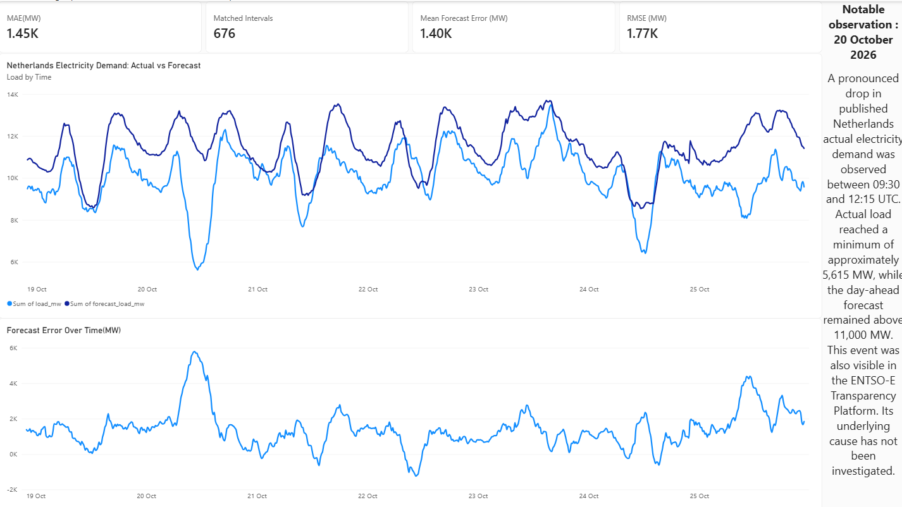

# GridPulse ⚡
### Netherlands Electricity Load Analytics & Forecast Evaluation

GridPulse is an end-to-end data engineering and analytics project that processes electricity demand data from the ENTSO-E Transparency Platform, compares actual electricity consumption with day-ahead load forecasts, and presents the results through an interactive Power BI dashboard.

The project demonstrates a reproducible data pipeline built with Python, Pandas, XML processing, Parquet storage, automated testing, and Power BI.

---

## Dashboard Preview



The dashboard provides:
- Actual electricity load vs. day-ahead forecast.
- Forecast error trends over time.
- Key forecast evaluation metrics.
- An observation highlighting a significant demand drop on 20 October 2026.

---

## Project Objectives

- Build a structured data pipeline for electricity demand data.
- Process and validate XML datasets from ENTSO-E.
- Transform raw data into analytical Parquet datasets.
- Compare actual electricity load with day-ahead forecasts.
- Calculate forecast evaluation metrics.
- Visualize results through Power BI.
- Implement automated tests and continuous integration.

---

## Technology Stack

| Technology | Purpose |
|---|---|
| Python | Data processing and pipeline development |
| Pandas | Data transformation and analysis |
| XML / ElementTree | Source data extraction |
| PyArrow / Parquet | Columnar data storage |
| Pytest | Automated testing |
| Git & GitHub | Version control |
| GitHub Actions | Continuous integration |
| Power BI | Interactive data visualization |

---

## Data Source

**Source:** ENTSO-E Transparency Platform

**Geographical coverage:** Netherlands

**Data categories:**
- Actual Total Load
- Day-Ahead Total Load Forecast

**Dataset characteristics:**

| Attribute | Value |
|---|---|
| Analysis period | 18–25 October 2026 |
| Time resolution | 15 minutes |
| Unit | MW |
| Time zone | UTC |
| Actual load records | 676 |
| Forecast records | 676 |
| Matched timestamps | 676 |

The dataset contains 676 observations because the selected period includes the autumn daylight-saving time transition in the Netherlands.

Raw XML files are stored locally and excluded from Git tracking.

---

## Data Pipeline Architecture

GridPulse follows a Bronze–Silver–Gold data architecture.

```text
        ENTSO-E Transparency Platform
                     |
                     v
              Raw XML Files
                     |
                     v
              BRONZE LAYER
           Original source data
                     |
                     v
              SILVER LAYER
          Parsing and validation
                     |
              +------+------+
              |             |
              v             v
        Actual Load    Day-Ahead Forecast
         Parquet           Parquet
              |             |
              +------+------+
                     |
                     v
               GOLD LAYER
         Forecast Comparison Dataset
                     |
              +------+------+
              |             |
              v             v
        Forecast Metrics  Power BI
                          Dashboard
```

### Bronze Layer
Stores the original ENTSO-E XML files without modifying the source data.

### Silver Layer
Extracts and validates actual load and day-ahead forecast records.

Validation includes:
- Timestamp parsing and UTC normalization.
- Numeric data type validation.
- Missing-value checks.
- Duplicate position and timestamp checks.
- Finite load-value validation.

Processed datasets are stored in Parquet format.

### Gold Layer
Combines actual load and forecast data using timestamps.

Additional analytical columns include:
- `error_mw`
- `absolute_error_mw`
- `squared_error_mw2`

Forecast error is calculated as:

**Forecast Error = Forecast Load − Actual Load**

---

## Forecast Evaluation

GridPulse calculates the following metrics:

| Metric | Result |
|---|---:|
| Mean Absolute Error (MAE) | 1,453.01 MW |
| Root Mean Squared Error (RMSE) | 1,770.57 MW |
| Mean Forecast Error | +1,398.62 MW |
| Matched Intervals | 676 |

### Metric Definitions

**Mean Absolute Error (MAE)**

Measures the average absolute difference between forecast and actual electricity load.

**Root Mean Squared Error (RMSE)**

Measures forecast error magnitude while assigning greater weight to larger errors.

**Mean Forecast Error**

Measures the average signed difference between forecast and actual load.

A positive mean forecast error indicates that the day-ahead forecast was higher than actual load on average during the selected period.

---

## Notable Observation

### Significant Demand Drop — 20 October 2026

A pronounced reduction in published Netherlands actual electricity demand was observed between 09:30 and 12:15 UTC.

During this interval:
- Actual demand reached a minimum of approximately 5,615 MW.
- Day-ahead forecast remained above 11,000 MW.
- Forecast error exceeded 5,700 MW at its largest.

The drop was also visible on the ENTSO-E Transparency Platform.

The underlying cause has not been investigated. The observations are retained in the dataset rather than removed from the analysis.

---

## Project Structure

```text
gridpulse/
│
├── .github/
│   └── workflows/
│       └── ci.yml
│
├── data/
│   ├── bronze/
│   ├── silver/
│   └── gold/
│
├── docs/
│   ├── images/
│   │   └── gridpulse_dashboard.png
│   └── data_source_notes.md
│
├── powerbi/
│   └── gridpulse_dashboard.pbix
│
├── src/
│   └── gridpulse/
│       ├── xml_loader.py
│       ├── silver.py
│       ├── run_silver.py
│       ├── run_forecast.py
│       ├── run_forecast_silver.py
│       ├── forecast_analysis.py
│       └── run_forecast_analysis.py
│
├── tests/
│   ├── fixtures/
│   ├── test_xml_loader.py
│   ├── test_forecast_loader.py
│   ├── test_silver.py
│   └── test_forecast_analysis.py
│
├── .gitignore
├── requirements.txt
└── README.md
```

---

## Running the Project Locally

### 1. Clone the repository

```bash
git clone <https://github.com/dhroov101/gridpulse.git>
cd gridpulse
```

### 2. Create a virtual environment

Windows PowerShell:

```powershell
python -m venv .venv
.venv\Scripts\Activate.ps1
```

### 3. Install dependencies

```bash
python -m pip install -r requirements.txt
```

### 4. Add the source data

Download the required actual total load and day-ahead total load forecast XML files from the ENTSO-E Transparency Platform.

Place them in the appropriate folders under:

```text
data/bronze/
```

The raw source files are not included in the Git repository.

### 5. Run the Silver pipeline

```bash
python -m gridpulse.run_silver
```

```bash
python -m gridpulse.run_forecast_silver
```

### 6. Generate the Gold dataset

```bash
python -m gridpulse.run_forecast_analysis
```

The resulting dataset is saved as:

```text
data/gold/forecast_comparison.parquet
```

### 7. Run automated tests

```bash
pytest -v
```

---

## Power BI Dashboard

The Power BI dashboard uses the Gold-layer Parquet dataset.

It includes:

1. Actual vs. day-ahead forecast line chart.
2. Forecast error over time.
3. MAE, RMSE and mean forecast error KPI cards.
4. Matched interval count.
5. A notable observation annotation.

The Power BI report is available in:

```text
powerbi/gridpulse_dashboard.pbix
```

Open the report using Power BI Desktop.

---

## Testing & Continuous Integration

GridPulse includes automated tests using Pytest.

The tests cover:
- Actual load XML parsing.
- Day-ahead forecast XML parsing.
- Invalid and malformed input handling.
- Silver-layer transformations.
- Parquet output and read-back.
- Forecast comparison and metric calculations.

GitHub Actions runs the automated test suite to help ensure changes do not break existing functionality.

---

## Limitations

- The current analysis covers one week of electricity demand data.
- Forecast metrics describe only the selected period.
- The observed demand drop has not been investigated for its underlying cause.
- No dedicated anomaly detection or forecasting model has been implemented.
- The project currently focuses on one geographical bidding zone: the Netherlands.

---

## Future Improvements

Potential extensions include:

- Automated ENTSO-E data ingestion.
- Scheduled pipeline execution.
- Broader historical electricity demand analysis.
- Advanced forecasting using machine learning.
- Anomaly detection and event analysis.
- Cloud-based data storage and orchestration.

---

## Author

**GridPulse** — An end-to-end data engineering and analytics portfolio project.

Built with Python, Pandas, PyArrow, Pytest, GitHub Actions, and Power BI.